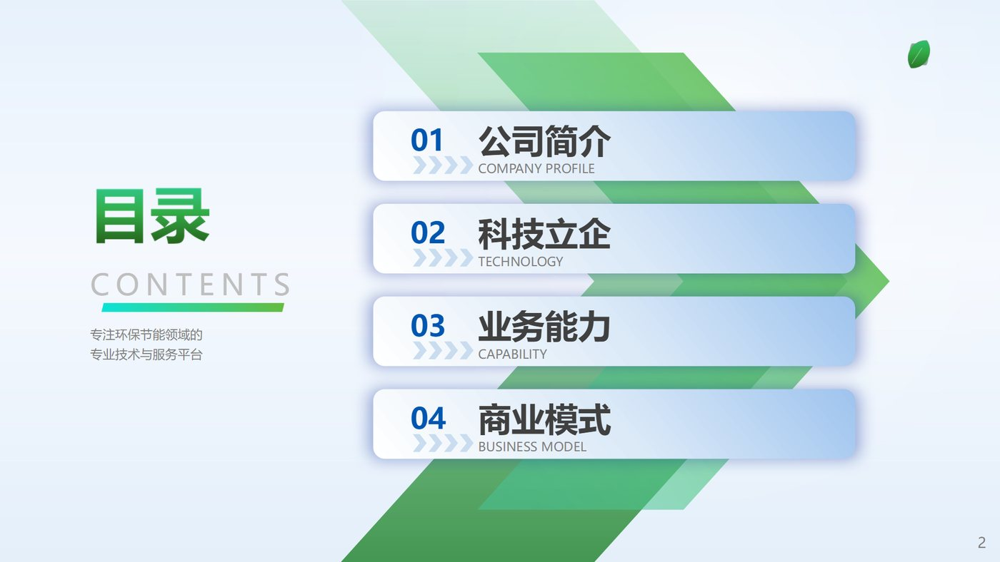
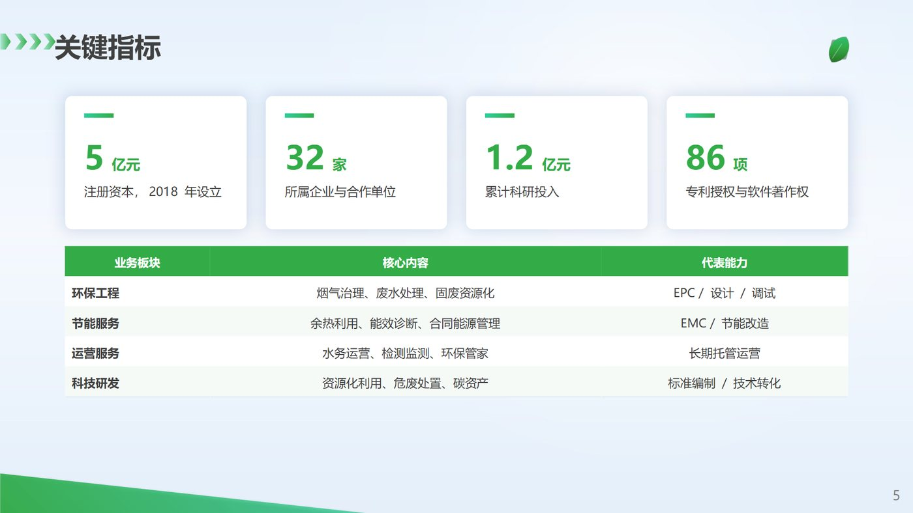

# 环保企业风格 PPT 技能 · chalco-env-deck

把一版「绿色环保企业」公司简介模板的**色调与版式**固化成一个可复用的 PPT 生成技能：
写十几行 Python，就能产出同样品牌感的封面、目录、章节页、内容页和结尾页。

仓库内所有素材（徽标、字标、二维码、底图）都是**代码生成的占位图**，
不含任何真实公司标识或版权照片；换成自己公司的素材只需覆盖 `assets/` 同名文件。





> 全部图片都是本仓库代码的实际渲染结果，见 [`references/previews/`](references/previews/)。

## 30 秒安装

**Windows（PowerShell）**

```powershell
irm https://raw.githubusercontent.com/chasingstars-a/chalco-env-deck/main/install.ps1 | iex
```

**macOS / Linux**

```bash
curl -fsSL https://raw.githubusercontent.com/chasingstars-a/chalco-env-deck/main/install.sh | bash
```

安装脚本只做三件事：下载仓库压缩包 → 复制到 `~/.dsh/skills/chalco-env-deck`（若检测到 `~/.claude` 也会复制一份到 `~/.claude/skills/`）→ 校验 `SKILL.md` 与脚本是否存在。
脚本很短，可以先[读一遍](install.ps1)再执行；不想联网也可以直接 clone 后手动复制：

```bash
git clone https://github.com/chasingstars-a/chalco-env-deck.git
cp -r chalco-env-deck ~/.dsh/skills/chalco-env-deck      # Windows: xcopy /E /I
```

**下载后手动运行**（VS Code / 公司电脑常见限制）：

```powershell
# Windows 默认禁止运行未签名脚本，加 -ExecutionPolicy Bypass 即可
powershell -NoProfile -ExecutionPolicy Bypass -File .\install.ps1
# 离线安装：先把仓库打成 zip，再
powershell -NoProfile -ExecutionPolicy Bypass -File .\install.ps1 -ZipPath .\chalco-env-deck.zip
```

```bash
chmod +x install.sh && ./install.sh --zip ./chalco-env-deck.zip
```

> 网络需要代理时：`install.ps1 -Proxy http://127.0.0.1:7890`，或先设 `HTTPS_PROXY` 环境变量。

## 它能生成什么

不用套模板、不用改占位符——用代码搭版式，内容改了版式不变：

```python
import sys
sys.path.insert(0, r"~/.dsh/skills/chalco-env-deck/scripts")   # Windows 用绝对路径
from chalco_deck import Deck, C, asset

d = Deck()                                                      # 16:9，微软雅黑
d.cover(title="公司简介", subtitle="2026 年度", location="中国 · 北京", date="2026.10")
d.toc([("公司简介", "COMPANY PROFILE"), ("科技立企", "TECHNOLOGY")])
d.section("01", "公司简介", en="COMPANY PROFILE", photo=asset("photo_leaf.jpg"))

p = d.page("关键指标")
p.kpis([("10", "亿元", "注册资本"), ("68", "家", "所属骨干企业")], box=(0.95, 1.4, 11.43, 1.9))
p.table(["能力", "说明"], [["技术研发", "1 个北京技术中心 + 8 个技术分中心"]],
        box=(0.95, 3.6, 11.43, 2.4))

d.closing()
d.save("公司简介.pptx")
```

### 页面骨架

| 方法 | 说明 |
|---|---|
| `d.cover(...)` | 封面：徽标 + 公司字标 + 主标题 + 副标题 + 地点/日期 |
| `d.toc([...])` | 目录：绿色双箭头色带 + 蓝白渐隐编号卡（3~6 条） |
| `d.section(no, title, ...)` | 章节页：大编号 + 标题 + 实景照片 + 绿尖角 |
| `d.page(title)` | 内容页：浅蓝光效底 + 绿色箭头标题 + 右上 logo + 页码 |
| `d.closing(...)` | 结尾页：致辞 + 绿色信息条 + 二维码 |

### 内容块

`p.bullets` 要点 · `p.text` 段落 · `p.image` 配图 · `p.cards` 多卡 · `p.card` 单卡 ·
`p.kpis` 指标卡 · `p.table` 表格 · `p.process` 箭头流程 · `p.banner` 尖头横幅 ·
`p.tags` 胶囊标签 · `p.note` 提示条 · `p.timeline` 时间线 · `p.chart` 原生图表

细节与版式图鉴见 [`references/layouts.md`](references/layouts.md)，配色/字号/栅格见
[`references/design-spec.md`](references/design-spec.md)。

## 设计规范（摘要）

| 名称 | 色号 | 用途 |
|---|---|---|
| 品牌蓝 | `#0056B0` | 徽标本体、目录编号、蓝色系标签 |
| 主绿 | `#33AC48` | 箭头、色块、表格头、项目符号 |
| 薄荷绿 | `#2FCF9D` | 渐变起点、强调短线、数字 |
| 深绿 | `#214B0D` | 字标渐变末端、深色标题 |
| 正文 | `#404040` | 标题与正文 |
| 浅蓝底 | `#F1F4FA` / `#B2D5FD` | 页面底、目录卡片 |

字体只用**微软雅黑**（中英文同一字族），标题加粗。所有页面 13.333 × 7.5 英寸。

## 成品自检

```bash
python scripts/check_deck.py 你的输出.pptx
```

检查：页面尺寸、字体、调色板外颜色、logo 是否齐全、页码、文字溢出、越界元素。0 error 才算过。

## 目录结构

```
chalco-env-deck/
├─ SKILL.md              技能入口（给 AI 读的指令）
├─ scripts/
│  ├─ chalco_deck.py     版式库（Deck / Page / 20+ 内容块）
│  └─ check_deck.py      成品自检
├─ assets/               占位素材：徽标、字标、底图、二维码
├─ references/           设计规范、版式图鉴、渲染图
├─ examples/             示例构建脚本（可跑出 10 页 demo）
└─ tools/                make_placeholders.py：重新生成全部占位素材
```

跑一下示例：

```bash
cd chalco-env-deck && python examples/build_demo.py   # 输出 ./demo/示例-公司简介.pptx
```

想换一套占位图的配色，直接改 `tools/make_placeholders.py` 顶部的颜色常量后重跑。

## 常见问题

**Q：一定要装 DeepSeek Harness 吗？**
不需要。`scripts/chalco_deck.py` 只依赖 `python-pptx` 和 `Pillow`，任何环境都能 import。
但 `SKILL.md` 是给 AI Agent 读的说明书——放在 `~/.dsh/skills/`（或 `~/.claude/skills/`）里，
Agent 才会自动按这套规范干活。

**Q：缺少微软雅黑怎么办？**
Linux/macOS 下请自行安装或替换字体（在 `chalco_deck.py` 顶部把 `FONT` 改成可用字体），
否则渲染会回落到默认字体，版式会偏。

**Q：公司网络需要代理？**
```powershell
.\install.ps1 -Proxy http://127.0.0.1:7890
# 或
$env:HTTPS_PROXY="http://127.0.0.1:7890"; irm ... | iex
```
git 用户可写进配置：`git config --global http.proxy http://127.0.0.1:7890`
（若报 `schannel: AcquireCredentialsHandle failed`，改用 `git -c http.sslBackend=openssl ...`）

**Q：能换成我们公司的 logo 吗？**
可以。用同名文件覆盖 `assets/logo_emblem.png`、`assets/logo_wordmark.png`（以及反白版），
保持约 205×209 与 16:1 的比例即可；二维码换 `assets/qr_wechat.png`。
底图想用真实照片，覆盖 `bg_cover_full.jpg` / `bg_light.jpg` / `bg_section.jpg` 等同名文件。

## 素材与许可

- **代码与占位素材**：MIT，见 [LICENSE](LICENSE)。`assets/` 里的徽标、字标、二维码、底图
  全部由 [`tools/make_placeholders.py`](tools/make_placeholders.py) 用几何与渐变合成，
  不含任何第三方商标或版权照片，可以随意修改、商用。
- **替换成自有素材后**：那部分素材的版权归你（或原权利人），不在本仓库许可范围内。
- **关于名字**：仓库名 `chalco-env-deck` 沿用自最初的内部代号，与任何公司无隶属关系；
  本仓库不包含该公司的标识、联系方式或业务数据。

---

本仓库的配色与版式取自一版绿色环保企业模板（颜色从矢量填充与 logo 像素采样，
版式按形状几何还原），文字与示例数据均为原创占位内容。
