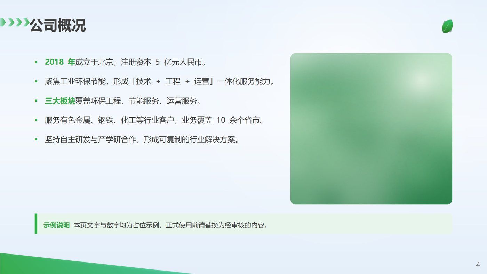
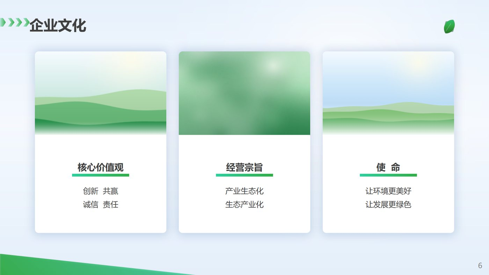
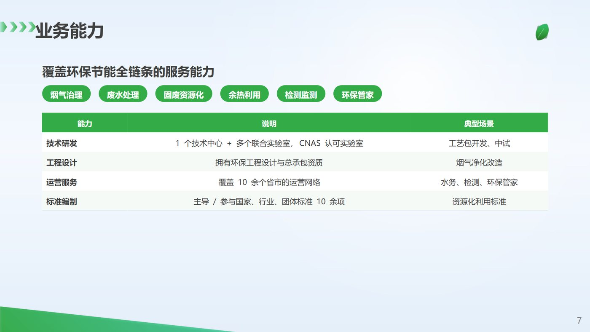
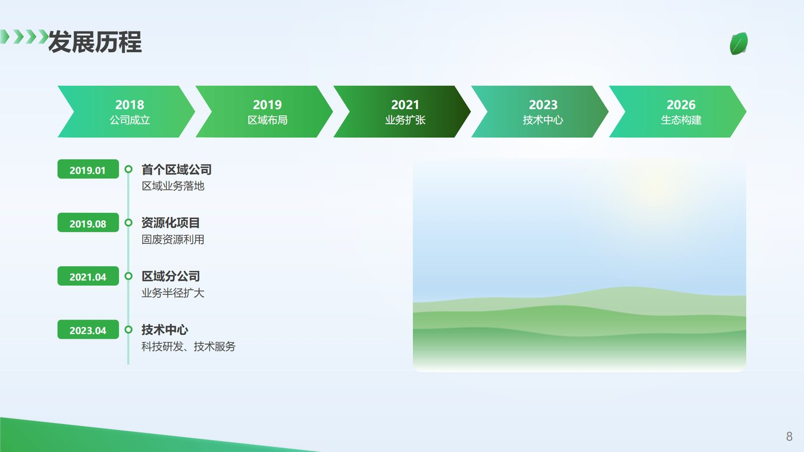
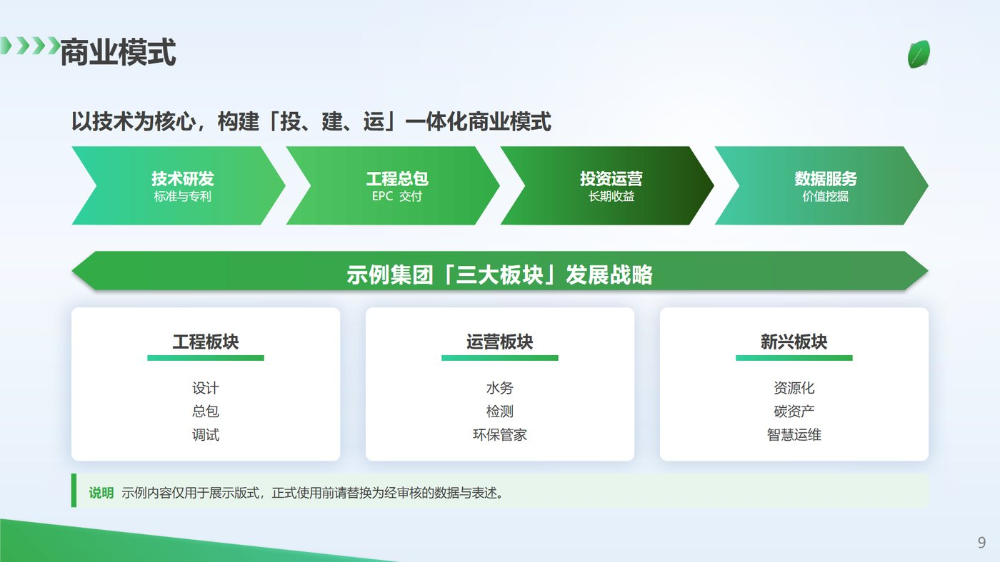

# 版式图鉴

每张图都是 `examples/build_demo.py` 的真实渲染（LibreOffice，1400×788）。
做新页面时先找一张最接近的照着改，不要从零发明版式。

## 封面 `Deck.cover(title=..., subtitle=..., location=..., date=...)`

- 底图 `bg_cover_full.jpg` 铺满，顶部叠白色渐变提亮（`overlay=0.42`）。
- 徽标 0.62 in 居中于 y=0.46；公司字标 4.53 in 于 y=1.16；主标题 y=1.92；强调线 y=2.97；副标题 y=3.12。
- 地点/日期底部居中、白色加粗 24 pt，带文字阴影。
- `Deck.cover()` 不传 title 时回到模板原味：大徽标 + 8.55 in 字标 + 英文全称。

## 目录 `Deck.toc([...])`

- 左侧：「目录」字标（1.20, 2.38）+ CONTENTS（28 pt 灰、字距 6）+ 绿青渐变斜块。
- 右侧：编号卡片 6.427×0.93，起始 y≈1.43，间距 0.307；卡片内 01 蓝色数字（28 pt）+ 4 个小箭头 + 标题 32 pt。
- 3~6 条都成立；超过 4 条间距自动收紧到 0.18。

## 章节页 `Deck.section("01", "公司简介", en=..., photo=...)`

- 全幅照片 + 左侧白色渐变（0.98 → 0）；绿色五边形尖角在左边缘垂直居中。
- 大数字 84 pt `#BFBFBF`，标题 44 pt，英文 12 pt 字距 +2.5，绿短线，最后是注释。
- 照片用 `photo_leaf.jpg` / `bg_section.jpg` 这类绿色自然图。

## 内容：要点 + 配图 `p.bullets()` + `p.image()`

- 左列要点宽 6.5，右列图 4.4×4.15，圆角 0.14。
- 要点 15 pt、行距 1.45、段后 12；绿色方块项目符号；行首可用 `[("加粗前缀", {"color": C.GREEN, "bold": True}), "正文"]`。
- 底部可用 `p.note()` 收一句结论。

## 内容：指标卡 + 表格 `p.kpis()` + `p.table()`

- 指标卡一行 4 个：绿色渐变短线 + 数值 34 pt + 单位 15 pt + 说明 13 pt。
- 表格表头绿底白字，正文 12.5 pt，第一列加粗；`col_widths` 按内容分配（合计自动归一）。
- 表格只保留行线，竖线与单元格底色同色。

## 内容：三卡阵列 `p.cards([...])`

- `card`：白底圆角 + 蓝柔光；顶图只圆上两角；标题 18 pt + 渐变短线 + 正文 15 pt（整块在图片下方垂直居中）。
- 卡片高 4.9~5.05 时观感最好；三卡间距 0.34。
- 没有图时（如「4 大核心产业」）正文自动居中，靠字号区分层级。

## 内容：标题 + 标签 + 表格 `p.tags()` + `p.table()`

- 顶部一行小标题 20 pt，下面一排胶囊标签（主绿底白字，高 0.36）。
- 表格区从 2.55 起，行高 0.44；行数 ≤ 6。

## 内容：流程 + 时间线 `p.process()` + `p.timeline()`

- 流程箭头一行 5 个，`adj=0.32`，标题 14 + 说明 12，白色文字居中。
- 时间线：时间胶囊（1.02×0.32，主绿）+ 竖线 + 空心圆点 + 标题/说明；一行一个里程碑。

## 内容：标题 + 流程 + 横幅 + 三卡

- 这是模板里「三大板块」那页的重构：小标题 → 4 段流程 → 双尖头横幅 → 3 张纯文字卡 → 底部提示条。
- 一页信息量偏大，只在该页确实是"总纲"时使用。

## 结尾页 `Deck.closing()`

- `bg_closing.jpg` 铺满；「分享结束 感谢聆听」字标（可用 `thanks=` 换文字）+ 英文。
- 底部绿色信息条：公司名 20 pt 白加粗 + 地址 13 pt；左侧二维码白卡 1.41 in。
- 地址用两个空格分组（`北京市昌平区  北七家镇…  8号楼5层`），不要换行。

## 页面节奏建议

一份 12~18 页的公司简介：

1 封面 → 2 目录 → 3 章节页(01) → 4 概况（要点+图）→ 5 关键指标（KPI+表）
→ 6 章节页(02) → 7 三卡（文化/能力）→ 8 流程+时间线 → 9 章节页(03)
→ 10 表格+标签 → 11 案例/项目 → 12 结尾。

每 3~5 张内容页插一张章节页，避免长段落连续出现。
